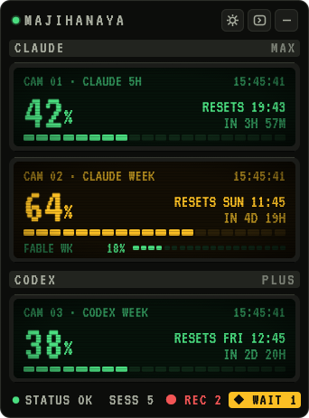
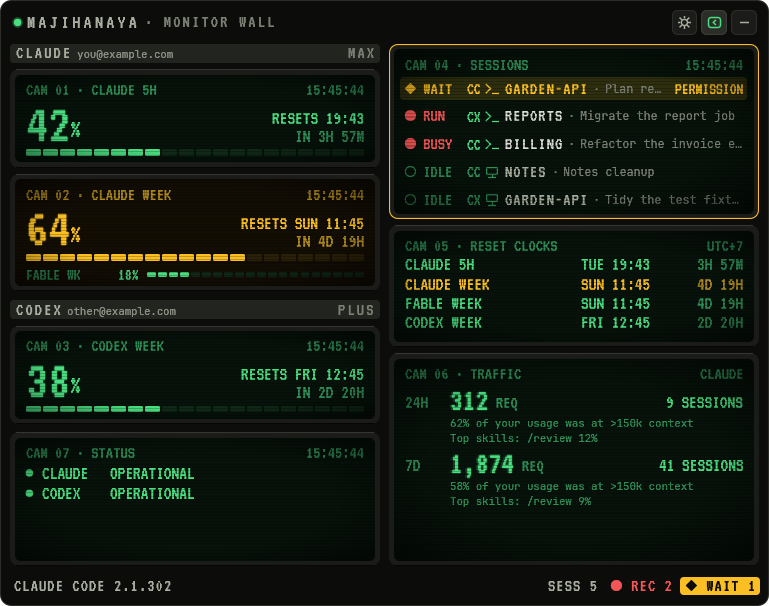
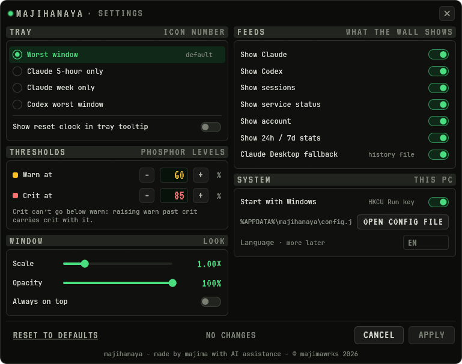

# majihanaya

A small Windows tray app that shows how much of your Claude and Codex plan
limits you have used, when each window resets, and which Claude Code and Codex
sessions are busy or waiting for you.

The tray icon shows one number: by default the highest percentage among the
current usage windows, coloured green, amber or red against your thresholds.
Click it to open the window.

| Compact | Details |
|---|---|
|  |  |



The screenshots use made-up accounts and sessions.

## What it shows

- Claude: the 5-hour session, the weekly limit and any per-model weekly
  limits, with reset times, plus the 24h / 7d request stats from `/usage`.
- Codex: every rate-limit window the Codex app-server reports.
- Sessions: Claude Code (CC) and Codex (CX) sessions running on this PC, and
  whether each is busy, idle or waiting for a permission prompt. Claude
  Desktop and ChatGPT Desktop each run all their sessions in one process, so
  each appears as one row showing its most recent session. Codex status is
  read from its session logs and is best effort: hover a Codex row for what
  its status can and can't tell.
- Service status for Claude and for the Codex parts of the OpenAI status page.
- The installed Claude Code version and whether a newer one is out.

Old numbers are never passed off as current: when a source stops answering,
its screen says so and the tray icon stops using it.

## Requirements

- Windows 10 or 11 (64-bit).
- For Claude usage: [Claude Code](https://docs.claude.com/en/docs/claude-code)
  installed and logged in (`claude auth login`).
- For Codex usage: the [Codex CLI](https://github.com/openai/codex) installed
  and logged in.

A tool that isn't installed is left out. The desktop apps on their own
(Claude Desktop, ChatGPT Desktop) are not enough: majihanaya reads usage
through the command-line tools, and never through the apps' own logins.

With only Claude Desktop installed, majihanaya shows the last numbers Claude
Desktop saved to disk, marked with how old they are, and says that full usage
needs Claude Code. Desktop saves those numbers only now and then, so they are
often hours old, and they have no reset times or stats.

## Install

Download `majihanaya.exe` from the
[latest release](https://github.com/majimawrks/majihanaya/releases/latest) and
run it. There is no installer. To start it with Windows, tick
"Start with Windows" in the tray menu or in Settings.

The exe is not code-signed, so SmartScreen may warn the first time you run it.

If you install Claude Code or the Codex CLI while majihanaya is running, choose
Restart in its tray menu. The installers add their folder to your PATH, and
Restart starts majihanaya again with that new PATH so it finds the tool.

At 100% the details and settings views are 615 px wide (the compact view
274 px). To make the window bigger, use Larger in the tray menu or the Scale
slider in Settings.

## How it gets the numbers

- Claude: runs `claude -p /usage` and `claude auth status`. These use no
  tokens. It uses `claude` from your PATH, or else the copy bundled with
  Claude Desktop (which only answers once it has been logged in). If the CLI
  can't answer, it can fall back to Claude Desktop's
  `plan-usage-history.json`: never when that file belongs to another
  organisation than the CLI login, and with only Claude Desktop installed,
  marked with its age (see Requirements).
- Codex: talks to `codex app-server` over stdio (no tokens spent). If that
  fails, it reads the newest `token_count` event from the Codex session logs.
- Sessions: reads the `*.json` files in `~/.claude/sessions` for Claude Code.
  For Codex, it finds running `codex.exe` processes and looks in the matching
  session log for the folder, when turns start and end, and whether a command
  is waiting for extra permissions. Your prompts, commands and Codex's replies
  are never kept or shown.

It never reads credential files or tokens. The only network requests are to
the Claude and OpenAI status pages and to Anthropic's Claude Code release
channel, all over HTTPS.

## Settings and files

Settings live in `%APPDATA%\majihanaya\config.json`. You can edit the file by
hand while the app runs; changes apply within a second. If the file can't be
read, the app starts with defaults and keeps a copy as `config.json.bad`.

Errors are logged to `%APPDATA%\majihanaya\majihanaya.log`.

## Building

```
cargo build --release
```

The exe ends up in `target\release\majihanaya.exe`. Needs a recent stable Rust
toolchain with the MSVC target.

`cargo run -- --dump` refreshes every source once and prints the result as
JSON, which is handy when something looks wrong.

Debug builds can start with made-up data for screenshots: set
`MAJIHANAYA_DEMO=1` (or `desktop` for a Claude Desktop-only setup),
`MAJIHANAYA_VIEW=details` or `settings` to pick the view, and
`MAJIHANAYA_SHOT=<file>` to save one frame as raw RGBA and exit.

## License

GPL-3.0-or-later. See [LICENSE](LICENSE).

Made by majima with AI assistance.
